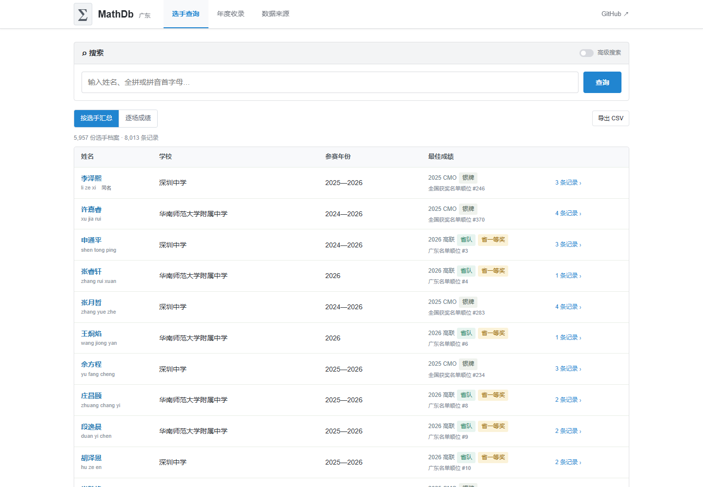
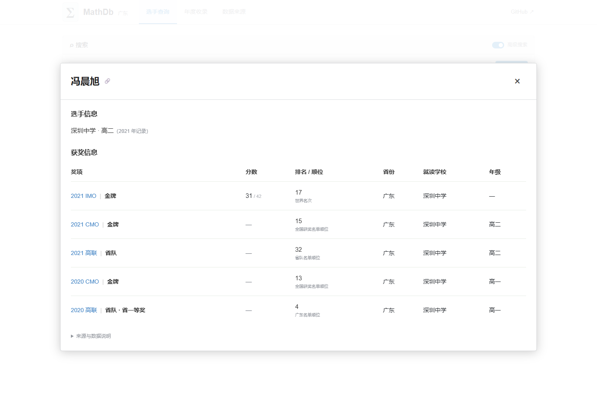

# 广东数学竞赛成绩查询 · MathDb GD

[在线查询](https://xhc144.github.io/gd-math-results/) · [数据来源](data/查询数据.json) · [CSV](data/广东数学竞赛记录.csv)

输入中文姓名、全拼或拼音首字母，查询广东数学竞赛历年记录。纯静态网页，下载仓库后双击 `广东数学竞赛成绩查询.html` 即可离线使用，无服务器、账号和外部资源依赖。



## 收录范围

- 高联 2020—2026：广东省一、省二、省三，省队 / 决赛名单。
- CMO 2020—2025：官方获奖名单中的广东记录，200 条。
- IMO：已核对中文身份的广东记录 4 条：饶睿 2020、彭也博与冯晨旭 2021、姜志城 2023；分数、单题成绩、世界名次来自 IMO 官网。
- 2026 报名表 2,566 行比对：1,549 行精确匹配、1,009 行“未获奖 / 缺考（未区分）”，8 行同名校名差异不武断归类。其余年份不据报名推断未获奖或缺考。

当前共 **8,013 条记录、36 份来源**，已归入 **5,957 份选手档案**，其中 1,514 份关联多条成绩。默认按选手汇总，一人一行；点击姓名打开完整历年履历，也可切换逐场成绩。筛选只决定哪些成绩匹配，个人页仍显示全部履历。CSV 中包含选手档案 ID。

个人档案依据同校同名、年级进度建立，校名简称与 OCR 粘连编号在索引中规范化，原表校名不改写。跨学校身份不明者、同场次同名学生分开；原表 `姓名1 / 姓名2` 标记不作为跨年身份凭据。年级进度不一致等情况标记“关联待核”，个人页提供其他同名档案入口。档案数量不等于全部经过人工核实的独立人数。人工合并须在 `data/个人关联更正.json` 保留理由与依据。

## 排名、分数与来源

IMO 显示官方世界名次，保留并列。高联显示省一、省二、省三名单依次排列后的广东名单顺位；CMO 显示原始获奖表中的全国名单顺位。后两者没有完整分数与并列信息，**不是官方竞赛名次**。未公开的分数留空，不作推算。报名差集不确认实际到场情况。

所有记录可打开原始附件对应页。公开来源来自广东省数学会（中山大学数学学院网站）、中国数学会、IMO 官网；IMO 中文身份另与学校官网交叉核对。2026 用户提供版本已与官网附件逐行比对。2020 省队 / CMO 使用公示稿，2026 省二 / 省三为公示名单。

往年扫描件经两轮识别、行数与编号锚点核验；人工补录 16 个漏检行，重点查看了 233 条低置信度姓名，修正 5 条，尚有 **6 条姓名字形待核**，网页有明确标记。没有声称全部姓名、学校和年级均已逐字人工校勘。提交更正请附原名单链接、页码与具体字形。



## 重建与维护

查询页面不需要安装依赖。仅从已核验的数据重建网页：

```bash
python source/render_site.py
python source/test_people.py
python source/validate_release.py
```

完整数据管线：

```bash
python -m pip install -r requirements.txt
python source/build_international.py
python source/build_data.py
python source/validate_release.py
python source/check_browser.py
```

浏览器检查使用本机 Microsoft Edge 无头模式；其他环境可在检查脚本改用已安装 Chromium。新增扫描 PDF 时用 `source/ocr_v6.py` 生成带坐标识别缓存，并复核 `data/人工更正.json`。OCR 缓存、原始文件与规范化 JSON 一并保存，已有数据重建不需要再次识别或联网。

`data/查询数据.json` 包含成绩与个人档案；`source/build_people.py` 生成可追溯的档案关联；`data/逐来源条目.json` 是来源账本；`data/人工更正.json` 是原表转录修订；`evidence/个人档案关联.json` 记录关联规则和待核边界。更正必须保留原始行和来源，不能凭同名合并身份。

## 开源与致谢

程序以 **AGPL-3.0** 开源，作者 xhc144。官方原始附件不纳入程序许可证，权利归原发布者。公开名单事实按来源保留与引用，不附加个人评价。

界面对照 [OIerDb](https://oier.baoshuo.dev/) / [OIerDb-ng/OIerDb](https://github.com/OIerDb-ng/OIerDb)（e104eb6）的 `Search`、`SearchResult`、`PersonCard`、`PersonInfo` 源码结构适配：折叠高级搜索、按人展示、姓名弹窗、选手信息与获奖表。适配为独立离线 HTML，保留 AGPL-3.0；不使用其徽标或信息学评分算法。
